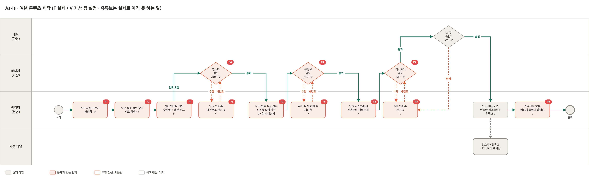
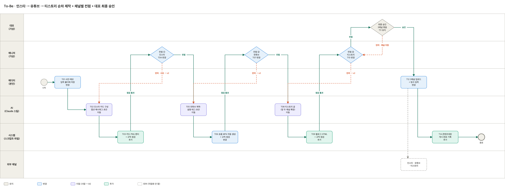
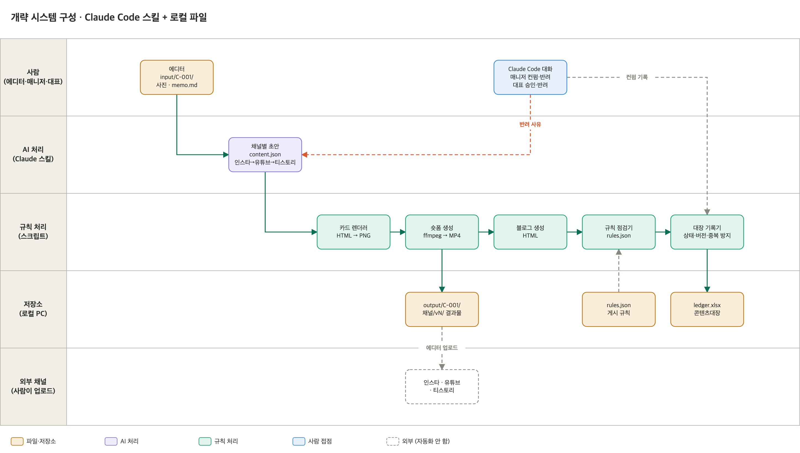

# 03. 업무 흐름도

> Draw.io 원본은 `diagrams/*.drawio` (app.diagrams.net 또는 Draw.io 앱에서 열기). 그림을 고치려면 `diagrams/build_diagrams.py`를 수정하고 `python3.12 diagrams/build_diagrams.py` 실행.

### 표시 규칙

| 표시 | 뜻 |
| --- | --- |
| **F** | 실제로 하고 있는 일 (1인 운영) |
| **V** | 가상 팀 설정 (대표·매니저 역할). 실제 1인 운영을 팀 업무로 확장해 가정한 부분 |
| 주황 점선 | 되돌림 (수정·반려) |
| 빨간 배지 P1~P6 | 문제 카드 번호 ([04 분석·설계](04_분석설계.md) 1-3) |

---

## 1. As-Is 프로세스맵

원본: [`diagrams/asis.drawio`](diagrams/asis.drawio)

| 단계 | 담당 | 작업 | 도구·자료 | 산출물·인계 | 근거 |
| --- | --- | --- | --- | --- | --- |
| A01 | 에디터 | 사진 고르기 | 휴대폰 사진첩 | 고른 사진 | F |
| A02 | 에디터 | 장소 정보 찾기 (위치·메뉴·영업시간) | 지도 앱·검색 | 메모 | F |
| A03 | 에디터 | 인스타 카드 수작업 (표지 `#지역 #동네` + 큰 제목) + 캡션·태그 작성 | 편집 도구 ⚠️ 미확인, 인스타 앱 | 카드 이미지·캡션 → 매니저 | F |
| A04 | 매니저 | 인스타 검토: 수정 필요? | 메신저 | 피드백 텍스트 | V |
| A05 | 에디터 | 수정 후 메신저로 재전송 → A04 | 메신저 | 수정본 | V |
| A06 | 에디터 | 숏폼용 사진을 다시 고르고 편집 앱으로 직접 편집 + 유튜브 제목·설명 작성 | 편집 앱 ⚠️ 미정, 유튜브 스튜디오 | 영상 → 매니저 | V (실제로는 작업 부담 때문에 아직 못 함) |
| A07 | 매니저 | 유튜브 검토: 수정 필요? | 메신저 | 피드백 | V |
| A08 | 에디터 | 다시 편집 후 재전송 → A07 | 편집 앱·메신저 | 수정본 | V |
| A09 | 에디터 | 티스토리 글을 처음부터 새로 작성 | 티스토리 에디터 | 글 → 매니저 | F |
| A10 | 매니저 | 티스토리 검토: 수정 필요? | 메신저 | 피드백 | V |
| A11 | 에디터 | 수정 후 재전송 → A10 | 메신저 | 수정본 | V |
| A12 | 대표 | 최종 승인? 반려 → A11 | 메신저 | 승인 여부 | V |
| A13 | 에디터 | 3채널 게시 (인스타·티스토리는 실제, 유튜브는 가정) | 각 앱 | 게시물 | F / V |
| A14 | 에디터 | 기록 없음 (메신저·폴더에 흩어짐) | — | — | V |

- 시작: 여행을 다녀와 사진을 고르기 시작함
- 종료: 3채널 게시
- 유튜브 구간(A06~A08)은 **팀이 수작업으로 한다면 이렇게 될 것**이라는 가정이다. 실제로는 이 편집 부담 때문에 유튜브를 하지 못하고 있다 (문제 P3).
- 대기 구간: 매니저 검토 대기(A04·A07·A10), 대표 승인 대기(A12)
- 재작업 경로: A04 ↔ A05, A07 ↔ A08, A10 ↔ A11, A12 → A11

---

## 2. To-Be 프로세스맵

원본: [`diagrams/tobe.drawio`](diagrams/tobe.drawio)

| 단계 | 담당 | 작업 | 변화 | As-Is |
| --- | --- | --- | --- | --- |
| T01 | 에디터 | 사진·메모를 입력 폴더(`input/C-001/`)에 저장 | 변경 | A01 |
| T02 | AI | 인스타 카드 구성(장별 사진·문구), 캡션, 해시태그 초안 | 이동 | A02·A03 |
| T03 | 시스템 | 카드 PNG 렌더링 + 게시 규칙 점검 | 추가 | A03 수작업 대체 |
| T04 | 매니저 | **컨펌 ① 인스타** — 반려 시 사유 → T02 새 버전 | 변경 | A04·A05 |
| T05 | AI | 유튜브 제목·설명·태그 초안 (승인된 카드 기준) | 이동 | A06 (제목·설명) |
| T06 | 시스템 | 승인된 카드로 숏폼 MP4(9:16) 자동 생성 + 규칙 점검 | 변경 | A06 (직접 편집) |
| T07 | 매니저 | **컨펌 ② 유튜브** — 반려 시 → T05 | 변경 | A07·A08 |
| T08 | AI | 티스토리 글 (승인된 인스타·유튜브 내용을 길게 확장) | 이동 | A09 |
| T09 | 시스템 | 블로그 HTML 생성 + 규칙 점검 | 추가 | — |
| T10 | 매니저 | **컨펌 ③ 티스토리** — 반려 시 → T08 | 변경 | A10·A11 |
| T11 | 대표 | **최종 승인 (3채널 묶음 1회)** — 반려 시 채널 지정 → 해당 컨펌 | 유지 | A12 |
| T12 | 에디터 | 3채널 업로드 + 링크 입력 | 변경 | A13 |
| T14 | 시스템 | 콘텐츠대장 `게시 완료` 기록 | 추가 | A14 대체 |
| — | — | 메신저 재전송(A05·A08·A11), 흩어진 기록(A14) | **제거** | A05·A08·A11·A14 |

- 모든 생성·점검·컨펌·반려·승인은 시스템이 콘텐츠대장에 자동 기록한다 (그림에서는 T14만 표시).
- 앞 채널이 컨펌되기 전에는 다음 채널을 만들지 않는다.
- 점검 실패 시 컨펌으로 넘기지 않고 같은 단계에서 다시 만든다.

### 줄어드는 것 / 새로 생기는 것

| 줄어드는 것 | 새로 생기는 부담 |
| --- | --- |
| 카드 표지 수작업, 채널별 재작성, 정보 검색 일부 | 메모에 장소명·지역·핵심 내용을 적는 일 |
| 메신저로 수정본 재전송 | 반려할 때 사유를 한 줄 적는 일 |
| 승인 버전 찾기 | 템플릿·게시 규칙 유지보수 |
| 유튜브 숏폼 제작 부담 | AI 초안의 사실 확인 (가격·영업시간 등) |

---

## 3. 개략 시스템 구성도

원본: [`diagrams/architecture.drawio`](diagrams/architecture.drawio)

| 구성요소 | 입력 → 처리 → 출력 | 지원 단계 | 책임 |
| --- | --- | --- | --- |
| 입력 폴더 `input/C-001/` | 사진·`memo.md` | T01 | 에디터 |
| Claude Code 대화 | 실행 요청, 컨펌·반려·승인 입력 | T04·T07·T10·T11 | 매니저·대표 |
| 채널별 초안 (AI) | 사진·메모·반려 사유 → `content.json` | T02·T05·T08 | AI (에디터가 사실 확인) |
| 카드 렌더러 | `content.json` + 사진 → HTML 템플릿 → PNG | T03 | 시스템 |
| 숏폼 생성 | 카드 PNG → ffmpeg → MP4 | T06 | 시스템 |
| 블로그 생성 | `content.json` + 사진 → HTML | T09 | 시스템 |
| 규칙 점검기 | 결과물 + `rules.json` → 점검표 | T03·T06·T09 | 시스템 |
| 대장 기록기 | 사건 → `ledger.xlsx` 한 줄 (중복 방지) | 전 단계 | 시스템 |
| 결과 폴더 `output/C-001/<채널>/vN/` | 버전별 결과물·점검표 보관 | — | 시스템 |
| 외부 채널 | 에디터가 직접 업로드 | T12 | 에디터 |

- 파일은 로컬 PC에 저장되지만, Claude에 전달한 사진·메모는 클라우드에서 처리될 수 있다.
- 실패 처리: 점검 실패 → `점검 실패` 기록 후 재생성 / 렌더링·영상 생성 실패 → `생성 실패` 기록, 완료로 표시하지 않음 / 순서 위반(앞 채널 미컨펌) → 실행 거절
